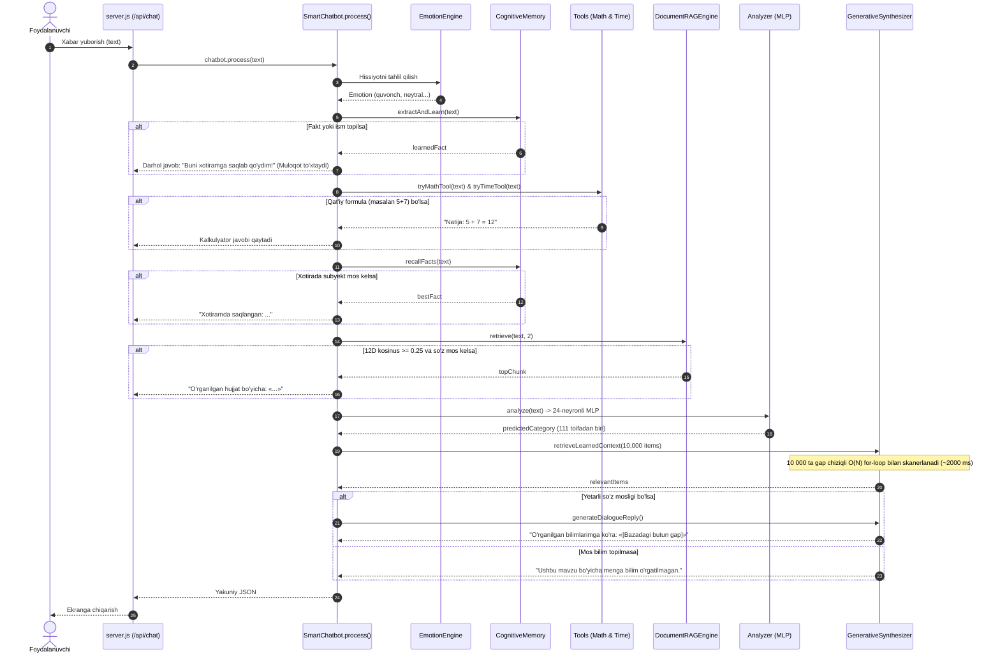

# PHASE 2 — ARCHITECTURE MAP & RUNTIME FLOW AUDIT

**Loyiha:** Neural Studio — Dynamic Intelligence & Universal Question Answering Engine  
**Bosqich:** Phase 2 Modul va Runtime Oqimi Tahlili  
**Sana:** 2026-10-17  
**Muallif:** Principal LLM Architect & Senior Systems Engineer  

---

## 1. MODULLAR INVENTARIZATSIYASI VA AMALDAGI VAZIFASI

Loyiha repository'sidagi barcha 29 ta modul to'liq tekshirildi. Ularning e'lon qilingan vazifasi va amaldagi runtime holati solishtirildi:

| Fayl | E'lon Qilingan Vazifasi | Amaldagi Runtime Holati | Baho / Muammo |
|:---|:---|:---|:---:|
| [`src/chatbot.js`](file:///home/user/Downloads/Telegram%20Desktop/llm_training_package/src/chatbot.js) | Asosiy suhbat va kognitiv orchestrator | Faol ishlaydi. Hamma oqim shu yerda birlashadi. | Ko'p tarmoqli qat'iy if/else zanjiri; vazifani dinamik dekompozitsiya qilmaydi. |
| [`src/analyzer.js`](file:///home/user/Downloads/Telegram%20Desktop/llm_training_package/src/analyzer.js) | Matn niyatini tahlil qiluvchi neyron modul | Faol ishlaydi. 24-neyronli MLP ga Bag-of-Words uzatadi. | Sintaksis va so'z tartibini inobatga olmaydi (Bag-of-Words). |
| [`src/neuralNetwork.js`](file:///home/user/Downloads/Telegram%20Desktop/llm_training_package/src/neuralNetwork.js) | 2-qatlamli neyron tarmoq (MLP) | Faol ishlaydi. 111 ta toifaga tasniflaydi (279K vazn). | Faqat klassifikator, til modeli (matn yaratuvchi) emas. |
| [`src/generativeSynthesizer.js`](file:///home/user/Downloads/Telegram%20Desktop/llm_training_package/src/generativeSynthesizer.js) | Semantik parafrazlash va dialog sintezi | Faol ishlaydi. Leksik qidiruv va POV shift qiladi. | Matn to'qimaydi; bazadagi jumlalarni `«...»` ko'rinishida ko'chirib beradi. `miniLLM` parametrini ishlatmaydi. |
| [`src/generator.js`](file:///home/user/Downloads/Telegram%20Desktop/llm_training_package/src/generator.js) | Attention-weighted Mini-LLM | Faqat `/api/generate` da ishlaydi, chatbotda uzilgan! | N-gram + untrained attention; Transformer checkpointini yuklay oladi, lekin chatga ulanmagan. |
| [`src/transformerModel.js`](file:///home/user/Downloads/Telegram%20Desktop/llm_training_package/src/transformerModel.js) | Causal Decoder-Only Transformer | Faol, lekin faqat testlarda va treningda. | 2 layer, 4 head, 154K parametr. Chatbotning real javob berish zanjiriga ulanmagan. |
| [`src/uzbekTokenizer.js`](file:///home/user/Downloads/Telegram%20Desktop/llm_training_package/src/uzbekTokenizer.js) | BPE Subword Tokenizer | Faol (Transformer uchun ishlaydi). | Chatbotning umumiy qidiruv tizimida ishlatilmaydi (oddiy regex ishlatiladi). |
| [`src/tokenizer.js`](file:///home/user/Downloads/Telegram%20Desktop/llm_training_package/src/tokenizer.js) | Butun so'zli tokenizator | Faol (MLP klassifikatori uchun). | Agglyutinativ o'zbek tilida yangi shakllarni OOV qiladi. |
| [`src/embeddings.js`](file:///home/user/Downloads/Telegram%20Desktop/llm_training_package/src/embeddings.js) | 12-o'lchamli so'z vektorlari (Skip-gram) | Faol ishlaydi. Qidiruvda kosinus hisoblaydi. | 12 o'lcham juda kam; begona so'zlarga 0.35-0.50 soxta kosinus yaqinlik beradi. |
| [`src/memory.js`](file:///home/user/Downloads/Telegram%20Desktop/llm_training_package/src/memory.js) | Kognitiv xotira va faktlar ombori | Faol ishlaydi. Simvolik JSON saqlagich. | Savollarni ("Barcha A lar B...") fakt deb xotiraga yozib oladi. |
| [`src/rag.js`](file:///home/user/Downloads/Telegram%20Desktop/llm_training_package/src/rag.js) | Hujjatlar bo'yicha RAG dvigateli | Faol, lekin `documents.json` da atigi 1 ta hujjat bor. | Vektor o'lchami pastligi sababli noto'g'ri hujjatlarni chaqiradi. |
| [`src/attention.js`](file:///home/user/Downloads/Telegram%20Desktop/llm_training_package/src/attention.js) | 1-boshli Self-Attention qatlami | Faol, lekin vaznlari o'qitilmagan (random). | Faqat UI da chiroyli heatmap ko'rsatish uchun xizmat qiladi. |
| [`src/multiHeadAttention.js`](file:///home/user/Downloads/Telegram%20Desktop/llm_training_package/src/multiHeadAttention.js) | 4-boshli Multi-Head Attention | Faqat `/api/attention/multihead` da. | Vaznlari o'qitilmagan; suhbatda ishlatilmaydi. |
| [`src/morphology.js`](file:///home/user/Downloads/Telegram%20Desktop/llm_training_package/src/morphology.js) | O'zbek tili morfologik lemmalari | `generativeSynthesizer.js` da ishlaydi. | `chatbot.js` da `this.morphology` yaratilgan, lekin hech qachon chaqirilmaydi. |
| [`src/illogicalEngine.js`](file:///home/user/Downloads/Telegram%20Desktop/llm_training_package/src/illogicalEngine.js) | Kategoriya xatolari va paradokslar tahlili | **UZILGAN (DEAD CODE).** | `chatbot.js:23,47` da import qilingan, lekin `process()` da chaqirilmaydi! |
| [`src/logicIdeaEngine.js`](file:///home/user/Downloads/Telegram%20Desktop/llm_training_package/src/logicIdeaEngine.js) | Biznes va arxitektura rejalari generatori | **UZILGAN (DEAD CODE).** | `chatbot.js:22,46` da import qilingan, lekin `process()` da chaqirilmaydi! |
| [`src/codeAgent.js`](file:///home/user/Downloads/Telegram%20Desktop/llm_training_package/src/codeAgent.js) | Kod yozish va tahlil qilish agenti | **UZILGAN (DEAD CODE).** | `chatbot.js:18,42` da import qilingan, lekin `process()` da chaqirilmaydi! |
| [`src/personaEngine.js`](file:///home/user/Downloads/Telegram%20Desktop/llm_training_package/src/personaEngine.js) | Persona, uslub va ohang boshqaruvi | Faol ishlaydi (ShortGate va Mood). | Qisqa so'zlarga tezkor javob beradi. |
| [`src/emotion.js`](file:///home/user/Downloads/Telegram%20Desktop/llm_training_package/src/emotion.js) | Matn hissiyotlarini aniqlash | Faol ishlaydi. Regex va leksik qoidalar. | Hissiyotni to'g'ri belgilaydi (quvonch, g'azab, neytral). |
| [`src/sandbox.js`](file:///home/user/Downloads/Telegram%20Desktop/llm_training_package/src/sandbox.js) | JS kodni VM ichida xavfsiz ishlatish | Faqat `/api/sandbox/run` da ishlaydi. | Chatbot bilan to'g'ridan-to'g'ri integratsiya qilinmagan. |
| [`src/session.js`](file:///home/user/Downloads/Telegram%20Desktop/llm_training_package/src/session.js) | Seanslarni faylda boshqarish | Faol ishlaydi. | Suhbat tarixini saqlaydi, lekin qidiruvga chuqur kiritilmagan. |
| [`src/db.js`](file:///home/user/Downloads/Telegram%20Desktop/llm_training_package/src/db.js) | Neon PostgreSQL bilan aloqa | Faol ishlaydi (fallback bilan). | Loglar va xotirani sinxronlashtiradi. |
| [`src/aiGateway.js`](file:///home/user/Downloads/Telegram%20Desktop/llm_training_package/src/aiGateway.js) | Tashqi AI API (OpenRouter/Gemini) | Faqat oflayn scriptlarda ishlaydi. | Inference'dan to'liq uzilgan (xavfsiz). |

---

## 2. AMALDAGI RUNTIME OQIMI (CURRENT MONOLITHIC FLOW)

Hozirda foydalanuvchi xabari kelganda tizim qat'iy bitta chiziqli zanjir bo'yicha harakatlanadi:



---

## 3. ARXITEKTURADAGI ZIDDIYATLAR VA NOCHOR YO'LLAR

### 3.1. "Memory Interception" Ziddiyati
* **Kod joyi:** `src/chatbot.js:169-194`
* **Ziddiyat:** Foydalanuvchi "Barcha A lar B. X — A. Bundan qanday xulosa chiqadi?" desa, `memory.extractAndLearn` regex orqali `—` yoki `bu` so'zini ko'rib, jumlani shaxsiy fakt deb qabul qiladi va `xotira_saqlash` rejimida darhol muloqotni yakunlaydi. Natijada mantiqiy savolga javob berilmaydi.

### 3.2. "Formula Regex vs Natural Language Math" Ziddiyati
* **Kod joyi:** `src/chatbot.js:80-97`
* **Ziddiyat:** `tryMathTool` faqat `5 + 7` yoki `100 / 4` ni taniydi. "5 ta kitobning har biri 10 000 so'm. Jami qancha?" kabi so'rovda regex ishlamaydi. Oqibatda bu so'rov retrievalga o'tib ketadi va Alining shaftoli sotib olgani haqidagi boshqa masalani ko'chirib beradi.

### 3.3. "Dead Code" Ziddiyati
* **Kod joyi:** `src/chatbot.js:18-24, 42-48`
* **Ziddiyat:** `illogicalEngine.js` va `logicIdeaEngine.js` fayllari mavjud, lekin chatbot ichida birorta ham chaqiruv yo'li yo'q. "Uchburchak necha kilo?" deyilganda `illogicalEngine` ning kategoriya xatosi tahlili chaqirilishi kerak bo'lgan joyda, tizim 10 000 ta gapdan "uchburchak" qidirib sarson bo'ladi.

### 3.4. "Generator Disconnect" Ziddiyati
* **Kod joyi:** `src/generativeSynthesizer.js:259`
* **Ziddiyat:** `miniLLM` obyekti funksiyaga argument qilib berilgan, lekin butun faylda birorta ham `miniLLM.generate()` yoki `miniLLM.predictNext()` chaqiruvi yo'q. Natijada "Generativ sintez" deb atalgan modul aslida oddiy string ko'chirgich bo'lib qolgan.

---

## 4. TAKLIF ETILAYOTGAN PHASE 2 DINAMIK ARXITEKTURASI

Qattiq if/else va chiziqli skanerlash o'rniga, quyidagi **ko'p qatlamli dinamik arxitektura** joriy etiladi:

```
                            FOYDALANUVCHI SO'ROVI
                                      │
                                      ▼
                   ┌──────────────────────────────────────┐
                   │    1. TASK UNDERSTANDING & INTENT    │
                   │  - Semantik maqsad (Goal)            │
                   │  - Ob'yektlar va munosabatlar (NER)  │
                   │  - Talab etilgan format va cheklovlar│
                   │  - Ko'p topshiriqli dekompozitsiya   │
                   └──────────────────┬───────────────────┘
                                      │
                                      ▼
                   ┌──────────────────────────────────────┐
                   │    2. DYNAMIC STRATEGY SELECTOR      │
                   │  (Vazifaga mos yo'lni dinamik tanlash)│
                   └──────┬───────┬───────┬───────┬───────┘
                          │       │       │       │
       ┌──────────────────┘       │       │       └──────────────────┐
       ▼                          ▼       ▼                          ▼
┌──────────────┐          ┌──────────────┐ ┌──────────────┐   ┌──────────────┐
│  REASONING   │          │ FAST HYBRID  │ │  COGNITIVE   │   │  ILLOGICAL & │
│   ENGINE     │          │  RAG SEARCH  │ │ MEMORY GRAPH │   │   PARADOX    │
│ - Arifmetika │          │- InvertedIdx │ │- Faktlar     │   │- Kategoriya  │
│ - Sillogizm  │          │- Subword BPE │ │- Profil      │   │  xatosi      │
│ - Ketma-ket  │          │- Dolzarblik  │ │- Munosabatlar│   │- Soxta taxmin│
│ - Taqqoslash │          │  saralash    │ │              │   │- Noaniqlik   │
└──────┬───────┘          └──────┬───────┘ └──────┬───────┘   └──────┬───────┘
       │                         │                │                  │
       └──────────────────┬──────┴────────────────┴──────────────────┘
                          │
                          ▼
                   ┌──────────────────────────────────────┐
                   │     3. EVIDENCE & CONTEXT AGGREGATOR │
                   │  - Topilgan dalillarni tekshirish   │
                   │  - Qarama-qarshiliklarni filtrlash   │
                   │  - Manba ishonchliligini baholash    │
                   └──────────────────┬───────────────────┘
                                      │
                                      ▼
                   ┌──────────────────────────────────────┐
                   │     4. RESPONSE GENERATOR & SYNTH    │
                   │  - Asosiy savolga to'g'ridan-to'g'ri  │
                   │  - Dalillarga tayangan xulosa        │
                   │  - Formatga moslashtirish (qisqa/uzun)│
                   │  - Halol noaniqlik bildirish         │
                   └──────────────────┬───────────────────┘
                                      │
                                      ▼
                   ┌──────────────────────────────────────┐
                   │     5. VERIFIER & FACT-CHECK GATE    │
                   │  - Asl savolga to'liq javob berildimi│
                   │  - Aloqasiz fakt aralashmadimi?      │
                   │  - To'qima/uydirma yo'qmi?           │
                   └──────────────────┬───────────────────┘
                                      │
                                      ▼
                              YAKUNIY SIFATLI JAVOB
```
