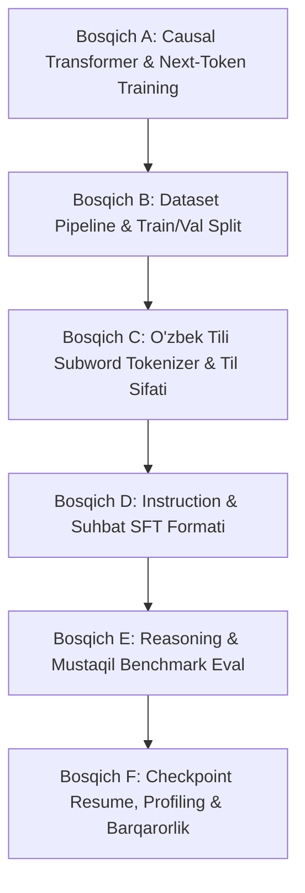

# BOSQICHMA-BOSQICH MUHANDISLIK REJASI: IMPLEMENTATION_PLAN.md
**Loyiha:** From-Scratch O'zbekcha Kognitiv Til Modeli (Uzbek LLM)  
**Texnik Arxitektura:** Causal Decoder-Only Transformer (Next-Token Prediction)  
**Status:** Tasdiqlangan / Amalga oshirishga tayyor

---

## 1. STRATEGIK ARXITEKTURA VA TEXNIK YONDASHUV

Mavjud apparat (i5-2400 CPU, 7 GB RAM, GTX 750 Ti 2 GB VRAM, 11 GB bo'sh disk) va dasturiy muhit (Node.js 22, Python 3.14 PyTorch-siz) sharoitida biz quyidagi eng oqilona, xavfsiz va yuqori unumdor arxitekturani tanlaymiz:

1. **Yadro: Causal Decoder-Only Transformer (Transformer-JS)**
   - Float32Array vektorlashtirilgan matritsa arxitekturasi;
   - Haqiqiy **Causal Attention Mask** ($i < j$ kelajak tokenlar $-\infty$ bilan to'siladi);
   - Multi-Head Self-Attention ($d_{model} = 64\text{ yoki }128$, $n_{heads} = 4$, $d_k = 16\text{ yoki }32$);
   - LayerNorm va Residual Add ($x + \text{SubLayer}(x)$);
   - Feed-Forward Network ($4 \times d_{model}$) + GELU faollashtirish funksiyasi;
   - Output Projection ($d_{model} \rightarrow V_{vocab}$) + Softmax Logits;
   - Causal Next-Token Cross-Entropy Loss hisoblash va Backpropagation gradient oqimi.

2. **O'zbek tili uchun moslashgan Subword/BPE Tokenizer**
   - Apostrof normalizatsiyasi (`ʻ`, `ʼ`, `‘`, `’`, `'`, `` ` `` $\rightarrow$ yagona standart `'`);
   - Lotin va kirill yozuvlariga chidamlilik;
   - Maxsus tokenlar: `<pad>: 0`, `<bos>: 1`, `<eos>: 2`, `<unk>: 3`;
   - OOV xatolarini bartaraf etuvchi subword bo'laklash.

3. **Train / Validation / Test qat'iy ajratilgan dataset pipeline**
   - Deduplikatsiya va normalizatsiya;
   - 80% Train, 10% Validation, 10% Test split;
   - Leakage prevention (bir xil yoki o'xshash jumlalar turli to'plamlarga tushishining oldini olish).

4. **100% Tashqi AI API-siz Lokal Autoregressive Inference**
   - KV Cache bilan yoki sof autoregressive decoding;
   - Temperature, Top-K va Top-P sampling;
   - `<eos>` tokenida to'xtash kafolati;
   - Mavjud `server.js` va `/api/chat` bilan backward-compatible integratsiya.

---

## 2. BOSQICHLAR (PHASES A — F)

---

### BOSQICH A — ISHLAYDIGAN MINIMAL LLM (CORE ARCHITECTURE)
* **Maqsad:** Haqiqiy decoder-only Transformer va next-token training loop'ni yaratish.
* **Vazifalar:**
  1. `src/transformerModel.js` yaratish:
     - Embedding Layer ($V \times d_{model}$);
     - Learned yoki Sinusoidal Positional Embeddings ($L_{max} \times d_{model}$);
     - Transformer Block: Causal Multi-Head Self-Attention + LayerNorm + Residuals + FFN (GELU);
     - Final LayerNorm + Output Projection ($d_{model} \times V$).
  2. Forward pass va backward pass (Gradient hisobi & Cross-Entropy Loss):
     - Targets: $y = x[1:]$, Inputs: $x = x[:-1]$;
     - Cross-Entropy Loss: $-\log(p(y_t | x_{1:t}))$.
  3. Parametrlar sonini aniq hisoblovchi test yozish.
* **Qabul mezonlari:**
  - Forward pass to'g'ri shakldagi (shape: `[batch, seq_len, vocab_size]`) logitlarni qaytaradi;
  - Causal mask kelajak tokenlariga e'tibor qaratishni $100\%$ to'sadi;
  - Sintetik ketma-ketlikda Cross-Entropy loss epoxalar davomida pasayadi.

---

### BOSQICH B — MA'LUMOT VA TRENING SIFATI (DATASET & REPRODUCIBILITY)
* **Maqsad:** Ma'lumotlarni tozalash, train/val/test split va gradient boshqaruvi.
* **Vazifalar:**
  1. `src/datasetPipeline.js` yaratish:
     - `knowledge.json` va Neon DB dan ma'lumotlarni yig'ish;
     - Exact va near-duplicate filtri (Normalized text hash);
     - Train (80%), Val (10%), Test (10%) ga deterministik random seed bilan bo'lish;
     - Dataset leakage auditini o'tkazish.
  2. `src/transformerTrainer.js` yaratish:
     - Adam optimizer (beta1=0.9, beta2=0.98, eps=1e-8, weight_decay=0.01);
     - Learning-rate warmup va cosine decay;
     - Gradient clipping (norm <= 1.0);
     - Har epoxada Train Loss va Validation Loss alohida hisoblash;
     - Best Validation Loss bo'yicha checkpoint saqlash.
* **Qabul mezonlari:**
  - Train va Val to'plamlari orasida 0 ta kesishish;
  - Val loss har N qadamda o'lchanadi va loglanadi;
  - Overfitting boshlanganda Early Stopping ishlaydi.

---

### BOSQICH C — O'ZBEK TILI SUBWORD TOKENIZER VA TIL SIFATI
* **Maqsad:** O'zbek tili morfologiyasiga mos keladigan subword/BPE tokenizatsiya.
* **Vazifalar:**
  1. `src/bpeTokenizer.js` yaratish:
     - Unicode apostroflarni unifikatsiya qilish (`o'`, `g'`, `sh`, `ch`);
     - Maxsus tokenlar: `<pad>`, `<bos>`, `<eos>`, `<unk>`;
     - Vocabulary training (BPE merge qoidalari);
     - Encode (`string -> token_ids[]`) va Decode (`token_ids[] -> string`);
     - Saqlash va yuklash (`data/bpe_vocab.json`).
  2. Tokenizer testlarini yozish:
     - O'zbekcha murakkab so'zlar: *"o'quvchilarimiznikidagilardanmisiz"*;
     - Belgilar va tinish belgilari;
     - Round-trip fidelity: `decode(encode(text)) === text`.
* **Qabul mezonlari:**
  - Hech qanday so'z butunlay tashlab yuborilmaydi (OOV bo'lmaydi, harflar/subword darajasida ifodalanadi);
  - Token IDs va Text o'rtasida 100% qayta tiklanish.

---

### BOSQICH D — INSTRUCTION VA SUHBAT (SFT PIPELINE)
* **Maqsad:** Modelni oddiy matn davomchisi emas, balki foydalanuvchi bilan savol-javob qiladigan shaklga keltirish.
* **Vazifalar:**
  1. Suhbat shablonini (Chat Prompt Format) standartlashtirish:
     - `<human>: [SAVOL]\n<bot>: [JAVOB]<eos>`
  2. Loss masking:
     - Loss faqat `<bot>` tokenlari uchun hisoblanadi (savol tokenlari uchun loss=0 qilinadi), shunda model savolni emas, aynan javob berishni o'rganadi.
  3. SFT (Supervised Fine-Tuning) datasetini tayyorlash.
* **Qabul mezonlari:**
  - Model prompt berilganda savolni takrorlamasdan, to'g'ridan-to'g'ri javobni davom ettirishni boshlaydi.

---

### BOSQICH E — REASONING VA MUSTAQIL BENCHMARK EVALUATION
* **Maqsad:** Modelning haqiqiy fikrlashini, mantiqini va xotirasini mustaqil testlar orqali o'lchash.
* **Vazifalar:**
  1. `tests/reasoningBenchmark.js` yaratish:
     - Yangi savolga moslik;
     - Sabab va oqibat;
     - Oddiy arifmetika (2+2, 10-3);
     - Ketma-ketlik va mantiq;
     - Kontekstni saqlash;
     - O'zbekcha imlo va tushunish.
  2. Avtomatlashtirilgan baholash va ball chiqarish rubrikasi.
* **Qabul mezonlari:**
  - Test to'plami trening datasetidan mutlaqo ajratilgan;
  - Har bir sinov natijasi avtomatik ravishda konsolga va faylga hisobot qilinadi.

---

### BOSQICH F — ISHONCHLILIK, CHECKPOINT RESUME VA RELEASE
* **Maqsad:** Treningni to'xtab qolganda davom ettirish, xotira sarfini nazorat qilish va serverga ulash.
* **Vazifalar:**
  1. Checkpoint to'liq holati:
     - Model og'irliklari, optimizer holatlari, epoxa, global_step, best_val_loss.
  2. `resume` funksiyasi va mos test.
  3. `server.js` va `/api/chat` ga yangi Causal LLM generatorini integratsiya qilish (eski niyat tasniflagichini saqlagan holda).
  4. `npm test` buyrug'ini tiklash (avtomatik regression testlar).
* **Qabul mezonlari:**
  - `npm test` xatosiz 100% o'tadi;
  - Trening o'rtasida to'xtatilib, yana qayta ishga tushirilganda aynan o'sha epoxadan davom etadi;
  - RAM sarfi 1.5 GB dan, disk sarfi 200 MB dan oshmaydi.
